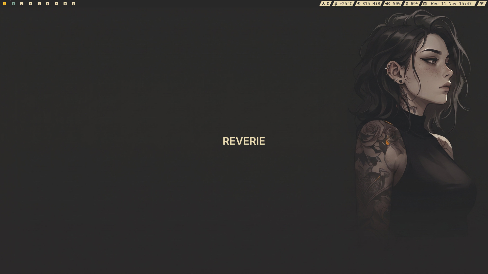

# nimdow-wl

nimdow-wl is a tiling window manager for Wayland. It runs as a window-manager client of the
[River](https://codeberg.org/river/river) compositor (0.5 or newer) through the `river-window-management-v1`
protocol: River handles rendering and input, nimdow-wl decides where windows go. It installs side by side with the
X11 `nimdow` package because every installed name differs (binary, config directory, session, man page, ...).

This is a Wayland port of [nimdow](https://github.com/avahe-kellenberger/nimdow) by avahe-kellenberger,
written in [Nim](https://nim-lang.org/). X11 is no longer supported. Licensed under the GPL-2.0 (see `LICENSE`).



## Features

- dwm-style tiling: master/stack layout with adjustable master count and width, tags (workspaces), floating and
  fullscreen windows, a scratchpad, multiple monitors, and app rules.
- Built-in status bar with tags, the focused window's title and status text with colours and click actions.
- System tray (StatusNotifierItem) with context menus and tooltips.
- Layer-shell support: launchers, notification daemons, wallpapers and other bars work.
- systemd user session integration, so `~/.config/autostart` entries run.
- Keyboard, touchpad and mouse settings in the config.
- TOML configuration with a reload key binding, plus a command line client for every window manager control.

## Quick start

On Arch Linux, install the complete desktop from the AUR and start it from a TTY:

```sh
yay -S nimdow-wl-desktop-git
river -c nimdow-wl
```

Press Super+/ to see all key bindings. For other setups, see [Installation](doc/installation.md).

## Documentation

| Document | Contents |
| --- | --- |
| [Installation](doc/installation.md) | Requirements, AUR packages, building from source, starting a session |
| [Configuration](doc/configuration.md) | Config file location, app rules, input devices, screen lock, key bindings overlay |
| [Controls](doc/controls.md) | Every control and its default key |
| [Status bar and tray](doc/status-bar.md) | Setting the status text, colours, click regions, system tray |
| [Command line](doc/command-line.md) | `nimdow-wl` options and running controls from scripts |
| [Coming from X11 nimdow](doc/coming-from-x11.md) | What works differently on Wayland |
| [Architecture](doc/architecture.md) | How nimdow-wl works under the hood |
| [Development](doc/development.md) | Building, tests, nested sessions |
| `man nimdow-wl` | Full reference of settings and controls |

`config.default.toml` documents every setting with comments.

## Known limitations

- Some clients ignore the size they are offered when they open floating. Alacritty (winit) is one: a floating
  rule's `width`/`height` is sent, but it opens at its own default size.
- `maximize_requested` is ignored.
- River sends no event for clicks that hit neither a window nor one of nimdow-wl's surfaces (the bare desktop), so
  an open tray menu is not dismissed by such a click; use Escape, a window, the bar or a tag change.
- Tray menus taller than the screen are not scrollable.
