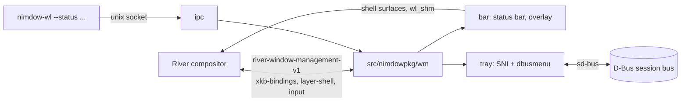

# Architecture

[Back to README](../README.md)

This page is an overview of how nimdow-wl works, for anyone who wants to read or change the code. It describes
the structure, not every detail; the doc comments at the top of most modules go deeper.

- [Big picture](#big-picture)
- [Source layout](#source-layout)
- [Startup](#startup)
- [Window management](#window-management)
- [Bar, overlay and menus](#bar-overlay-and-menus)
- [System tray](#system-tray)
- [Command line client](#command-line-client)
- [Config reload and input devices](#config-reload-and-input-devices)
- [Protocol bindings and tests](#protocol-bindings-and-tests)

## Big picture

nimdow-wl is not a compositor. [River](https://codeberg.org/river/river) is the compositor: it owns the outputs, the
input devices, rendering and the windows' surfaces. nimdow-wl is a *window manager client* of River, speaking the
`river-window-management-v1` protocol (plus the XKB bindings, layer shell and input management protocols). River is
started with `river -c nimdow-wl`, which runs nimdow-wl as River's init command.

| River | nimdow-wl |
| --- | --- |
| Draws windows, composites, talks to the hardware | Decides which windows are shown, where, and which has focus |
| Tells nimdow-wl about windows, outputs, seats, key presses | Owns tags, layouts, app rules, key bindings, bar, tray |
| Waits for nimdow-wl's decisions inside "sequences" | Answers every sequence with positions, sizes and focus |

The bar, the hotkey overlay and the tray menus are drawn by nimdow-wl itself, as surfaces River places for it.

## Source layout

`src/nimdow.nim` is the entry point: startup and the event loop. Everything else is in `src/nimdowpkg/`:

| Directory | Contents |
| --- | --- |
| `wm/` | The window manager: state types, monitors, tags, master/stack layout, River event handlers, actions |
| `config/` | TOML config loading (`configloader.nim`), key parsing, app rules, per-tag settings |
| `bar/` | Status bar, status text parsing (ANSI), fonts, pointer input, hotkey overlay |
| `tray/` | System tray: sd-bus bindings, StatusNotifier watcher/host, dbusmenu, icons, menu popups |
| `ipc/` | Unix socket server (`ipc.nim`) and command line parsing/client (`cli.nim`) |
| `wl/` | Wayland client helpers, cairo/pango/rsvg bindings, wl_shm buffers, and generated `protocols/` |
| `sys/` | Logger, child process spawning, desktop session integration |

Key files in `wm/`:

| File | Role |
| --- | --- |
| `types.nim` | The `WindowManager` object and shared helpers such as `markDirty` |
| `windowmanager.nim` | Connects to River, binds the globals, registers the listeners |
| `sequence.nim` | `onManageStart` and `onRenderStart`: flush state to River |
| `windows.nim` | River window events, app rules, new window placement |
| `outputs.nim`, `monitor.nim` | Outputs and the `Monitor` (tags, clients, bar, usable area) |
| `clientlist.nim`, `tags.nim`, `client.nim` | Per-tag client lists and the `Client` object |
| `masterstack.nim`, `area.nim` | The master/stack layout and geometry |
| `seats.nim` | Seats, key bindings, pointer move/resize |
| `actions.nim`, `commands.nim` | Everything a key binding or IPC command can do; the command names |
| `inputconfig.nim` | Keyboard and libinput settings |
| `overlay.nim`, `debug.nim` | Hotkey overlay control; `--dumpState` |

## Startup

`src/nimdow.nim` does this, in order:

1. `cli.handleCommandLineParams()` parses the arguments. A control command is sent to the running instance and the
   process exits (see [Command line client](#command-line-client)). `--version` and `--config <path>` are handled here too.
2. `newConfig()` and `loadConfigFile()` read the config. If the file is missing or broken, the embedded default config is
   used so key bindings always exist.
3. SIGTERM and SIGINT are routed to a self-pipe so the event loop can end cleanly and run the exit procs.
4. `newWindowManager()` (`wm/windowmanager.nim`) applies the config, connects to the Wayland display, lists the
   registry (`wl/client.nim`) and binds `river_window_manager_v1`, `river_xkb_bindings_v1`, the optional
   `river_layer_shell_v1`, the input globals, and the bar's globals (compositor, shm, viewporter, fractional scale).
   It then does one roundtrip to receive the initial outputs and seats. If another window manager already runs,
   River sends `unavailable` and nimdow-wl exits.
5. The IPC socket is created, so early clients can already connect.
6. `startSession()` (`sys/session.nim`) exports the display variables to the systemd user manager and the D-Bus
   activation environment, and starts `nimdow-wl-session.target` (which pulls in XDG autostart). It is skipped when
   `NIMDOW_NO_SESSION` is set, as the tests and `nimble nested` do. The target is stopped again on exit.
7. A SIGCHLD reaper is installed, the tray is started, and the `[autostart]` commands run (`sys/spawn.nim`).
8. The main loop runs. One selector watches the Wayland fd, the IPC socket, the quit pipe and the tray's D-Bus fd.
   Each turn follows the libwayland read protocol (dispatch queued events, flush, wait, read, dispatch). The wait
   timeout comes from the tray and the menu timers. Then IPC commands are handled, `tray.process()` runs and due
   timers fire.

## Window management

River is double buffered. nimdow-wl keeps its own state (`Client`, `Monitor`, `TaggedClients`) and only sends it to
River inside a *sequence*:

- Event handlers and actions only change nimdow-wl's state.
- `manage_start` (`onManageStart` in `wm/sequence.nim`): process closed windows, update the selected monitor from the
  pointer, place new windows, apply client requests (fullscreen, move/resize), then send show/hide, fullscreen,
  proposed dimensions, focus and bindings. It ends with `manage_finish`.
- `render_start` (`onRenderStart`): set window positions, borders and stacking order, then `render_finish`.
- Anything that changes state outside a sequence (an IPC command, the bar, a timer) calls `markDirty`, which sends
  `manage_dirty` so River starts a manage sequence.

Concepts:

- **Tags** replace workspaces. Each monitor has tags; a window can be on several, and several tags can be viewed at
  once. The code is in `wm/clientlist.nim` and `wm/monitor.nim`, and the per-tag settings in `config/tagsettings.nim`.
- **Master/stack** (`wm/masterstack.nim`): the first N windows share the master area, the rest are stacked beside it.
  The monitor's usable area excludes the bar and the space reserved by layer surfaces.
- **Floating**: floating windows keep their own position and size and are drawn above tiled ones. Tiled windows are
  told they are tiled (`set_tiled`). nimdow-wl draws its own borders and asks clients to use server-side decoration.
- **Fullscreen**: River does the sizing; nimdow-wl sends `fullscreen`/`exit_fullscreen` for the monitor's output.
- **App rules** (`config/apprules.nim`, applied in `wm/windows.nim`): matched by app id and title; a rule can set
  tags, monitor, floating or fullscreen state and geometry. A new window often has no app id or title yet, so
  `assignUnassigned` holds it back for one manage sequence. If the title arrives later, `applyLateRules` runs the
  rules again, but only within 500 ms of the placement and only if no rule matched yet. Then only tags and
  floating/fullscreen apply.
- **Focus** follows the selected client of the selected monitor, unless a layer surface or a tray menu holds the
  keyboard. The selected monitor follows the pointer.

## Bar, overlay and menus

All three are drawn by nimdow-wl, not by River.

- **Surfaces**: each is a `wl_surface` made into a `river_shell_surface_v1` through the window management protocol,
  not a layer-shell surface. The bar exists once per monitor (`bar/statusbar.nim`). The hotkey overlay
  (`bar/overlay.nim`) and each tray menu level (`tray/traymenu.nim`) exist only while open.
- **Drawing**: cairo and pango (hand-written bindings in `wl/cairo.nim`) draw into a double-buffered `wl_shm` pool
  (`wl/shm.nim`). Tray icons (PNG, SVG, SNI pixmaps) are rendered by `tray/icons.nim`, SVG through librsvg (`wl/rsvg.nim`). Fonts and colours are
  shared (`bar/fonts.nim`, `bar/render.nim`); status text is parsed by `bar/statusparse.nim`.
- **Fractional scale**: `ScaledSurface` in `wl/shm.nim` uses `wp_fractional_scale_v1` with `wp_viewporter`. The buffer is
  rendered at the physical size and the viewport destination is the logical size. Without those protocols it falls
  back to the integer buffer scale. Drawing code works in logical units.
- **Timing**: commits happen in `flush`, which runs only during a manage or render sequence. The commit is
  synchronised with `sync_next_commit` so the surface changes appear together with the window layout.
- **Input**: pointer events arrive on nimdow-wl's own connection (`bar/input.nim`, which also binds `wl_seat`). Clicks
  are queued and handled in the next manage sequence; `requestManage` asks River to start one.

## System tray

`tray/tray.nim` implements the StatusNotifierItem protocol over D-Bus with sd-bus (`tray/sdbus.nim`; the vtable part
is in `tray/watcher_vtable.c`).

- **Watcher**: nimdow-wl tries to own `org.kde.StatusNotifierWatcher`, without replacing another owner. If it gets the
  name, apps register their items with it.
- **Host**: it also owns `org.kde.StatusNotifierHost-<pid>`. If another program owns the watcher (for example waybar),
  nimdow-wl only acts as a host and follows that watcher's items and signals. It takes over the name if that program
  goes away.
- **Items**: properties are fetched with asynchronous `GetAll` calls. `New*` signals trigger a debounced refetch.
  Nothing blocks the event loop.
- **Menus**: `tray/dbusmenu.nim` is the client side of `com.canonical.dbusmenu` (layout replies parsed into
  `tray/menutree.nim`). `tray/traymenu.nim` draws the popups and runs the menu state machine in manage sequences.

## Command line client

`nimdow-wl --status`, the controls and `--dumpState` all use the same path (`src/nimdowpkg/ipc/`):

1. `cli.nim` takes the first argument; if it is a known command in `wm/commands.nim`, it builds the message
   `nimdow-ipc <command> [argument]`.
2. `ipc.findSocketPath()` picks the newest live socket `ipc-socket.<pid>` in `$XDG_RUNTIME_DIR/nimdow-wl/`. Without
   `XDG_RUNTIME_DIR` it uses a private directory in `/tmp`, which must be owned by the user and closed to others.
3. The client connects to the Unix socket, sends the message and closes. The running instance accepts it in the
   main loop, reads it (at most 64 KiB, with a 20 ms limit for a silent client), and `handleCommand` in
   `src/nimdow.nim` runs it.
4. `--status` sets the bar text and calls `markDirty`. Other commands go to `runIpcAction` (`wm/actions.nim`), the same
   actions key bindings use. `--dumpState` writes the state as JSON (`wm/debug.nim`); a relative path is made
   absolute first.

## Config reload and input devices

- **Reload** is the `reloadConfig` command (a key binding or `nimdow-wl --reloadConfig`). There is no file watcher. The file is
  read strictly: if it is broken, the running config stays. Otherwise the monitors, input settings and tray (started,
  stopped or re-themed) are updated, and key bindings are recreated in the next manage sequence.
- **Input** (`wm/inputconfig.nim`): River exposes each device as three linked objects (`river_input_device_v1`,
  `river_xkb_keyboard_v1`, `river_libinput_device_v1`). Settings from `[input]` are applied when a device is complete,
  when the keymap is ready and on reload. Unset settings are never sent. None of this needs a manage sequence.

## Protocol bindings and tests

- `protocol/*.xml` holds the protocol files. `nimble wlgen` runs `tools/wlgen.nim`, which writes
  `src/nimdowpkg/wl/protocols/<name>.nim` and runs `wayland-scanner` for the `_protocol.c` interface tables. The
  generated files are committed; do not edit them by hand.
- Unit tests are in `tests/nimdowpkg/`, mirroring `src/nimdowpkg/` (`bar`, `config`, `tray`, `wm`).
- End-to-end tests are in `tests/e2e/`: they run nimdow-wl in a nested River, inject input and check state with
  `--dumpState`.

See [Development](development.md) for how to build and run them.
